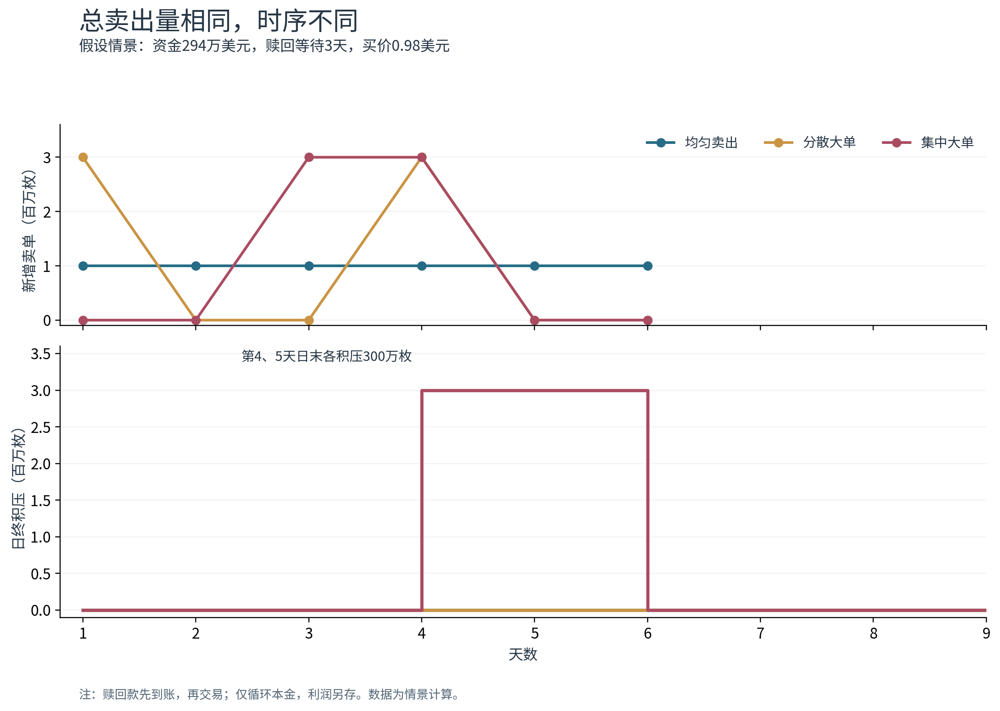
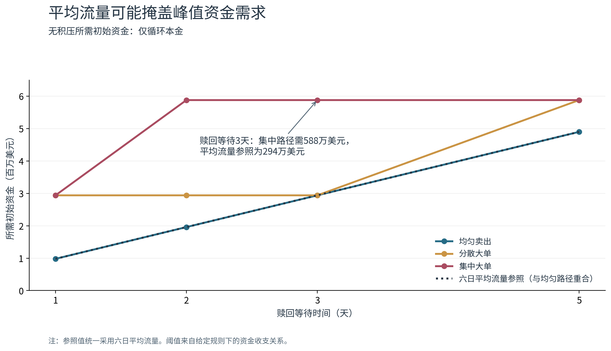

# 稳定币套利的资金周转与卖单时序

本项目比较一个简单问题：总卖出量和六日平均流量相同，卖单到达时间不同，有限资金能否持续承接？

这是固定买价、确定赎回时间的情景分析。模型输出是给定报价下的卖单积压和等待成交时间，不是稳定币价格，也不是对USDC历史事件的实证估计。

## 复现方法

需要 Python 3.10 或以上。在项目目录下执行：

```bash
python -m venv .venv
# macOS / Linux
source .venv/bin/activate
# Windows PowerShell 对应命令：.venv\Scripts\Activate.ps1
python -m pip install -r requirements.txt
python -m unittest -v
python run_experiments.py
```

`requirements.txt` 给出最低依赖版本；`requirements-reproduction.txt` 记录此次运行使用的精确版本，适合 Python 3.12 环境。运行会覆盖 `results/` 和 `figures/` 中的生成文件。主实验没有随机抽样；测试中的随机检查使用固定种子。

第一次生成图表时，程序会从Noto官方项目下载约16MB的中文字体，校验SHA-256后缓存在 `assets/fonts/`，需要网络连接；之后可离线生成。字体许可证随项目提供。无法联网时，可提前把 `NotoSansCJKsc-Regular.otf` 放入该目录；程序会同样校验其版本。SVG保留文字对象，查看时可能需要安装该字体。不同软件环境下，图片排版和环境记录可以略有差异，数值结果应一致。

字体来源：[Noto Sans CJK SC](https://github.com/notofonts/noto-cjk/tree/main/Sans/OTF/SimplifiedChinese)，校验值为 `2c76254f6fc379fddfce0a7e84fb5385bb135d3e399294f6eeb6680d0365b74b`。

## 设定和单位

资金单位为百万美元，币数量为百万枚，价格单位为美元/枚。每天先处理到期赎回，再接受新卖单并成交；第 t 天买入的币在第 t+T 天交易前兑回1美元。未成交卖单按先到先成交处理。

| 参数 | 取值 |
| --- | --- |
| 买入价格 p | 0.98 |
| 赎回等待 T | 1、2、3、5天 |
| 初始可用资金 B | 0.98、1.96、2.94百万美元 |
| 均匀卖出 | [1,1,1,1,1,1] |
| 分散大单 | [3,0,0,3,0,0] |
| 集中大单 | [0,0,3,3,0,0] |
| 基准情景 | 赎回本金再投入，利润另存 |
| 稳健性比较 | 赎回本金和利润均再投入 |

三条路径总量均为600万枚；每种利润规则有36组情景，共72组。

## 主要指标与结果

最大积压是各日日终未成交数量的最大值。平均等待时间按成交数量加权，从卖单到达到成交计时：当天成交记0天，次日成交记1天；不包括成交后的赎回等待。它也等于日终积压之和除以总卖单量。

仅循环本金时，无积压所需初始资金等于买价乘以任一连续T天窗口内的最大累计卖单量：

```text
B_min = p × max_t Σ_(j=0,...,T-1) s_(t-j)
```

观察期外的卖单量记为0。该条件依赖上述确定赎回和先到账后交易等规则。

当资金为294万美元、赎回等待3天时，均匀和分散路径无积压，集中路径最大积压300万枚，平均等待成交1天。三条路径在第6天均已全部成交，说明期末全部成交不能反映过程中是否存在承接缺口。





36组基准情景中，是否出现积压均与资金阈值一致。利润再投入使9组情景的最大积压下降、22组平均等待缩短，其余对应指标不变；重点对照仍成立。

## 文件说明

| 文件 | 内容 |
| --- | --- |
| `simulator.py` | 逐日资金、赎回和FIFO成交引擎 |
| `run_experiments.py` | 参数配置、72组计算及中文绘图 |
| `test_simulator.py` | 手工核算、FIFO、时间平移、利润再投入及2000组随机阈值检查 |
| `results/scenario_summary.csv` | 每组情景的汇总指标 |
| `results/daily_traces.csv` | 每日现金、在途本金、成交和积压 |
| `results/fifo_fills.csv` | 各批卖单的成交日、成交量和等待时间 |
| `results/reinvestment_comparison.csv` | 两种利润规则的逐组比较 |
| `results/funding_thresholds.csv` | 滚动窗口阈值与六日平均流量参照 |
| `results/focus_cases.csv` | 资金294万美元、等待3天的重点比较 |
| `results/run_config.json` | 运行参数及环境版本 |
| `results/validation_summary.json` | 核查结果摘要 |
| `figures/` | 三张图的PNG和SVG版本 |

## 解释边界

模型不包含价格调整、手续费、融资利息、储备损失、赎回容量限制、新增借款或持有人策略。不能将积压数量解释成脱锚幅度，也不能据此认定实际脱锚仅由赎回延迟造成。资金阈值首先来自资金收支关系，本项目用不同卖单时序展示其含义。

## 许可

原创代码采用MIT许可证，见 `LICENSE`。附带的Noto Sans CJK字体单独遵循SIL Open Font License，见 `assets/fonts/OFL.txt`。
